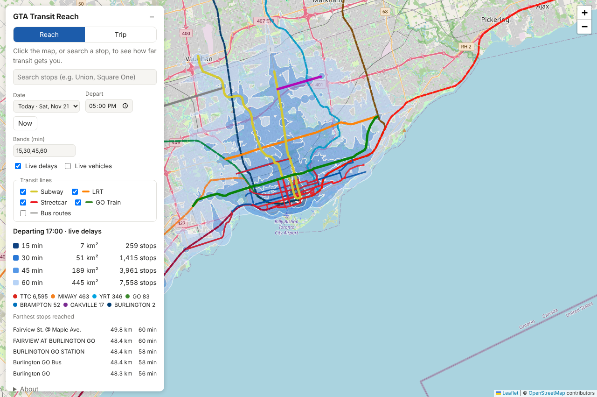
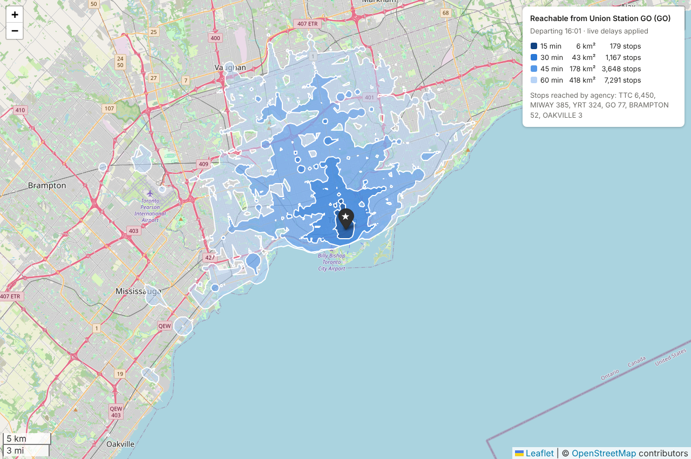
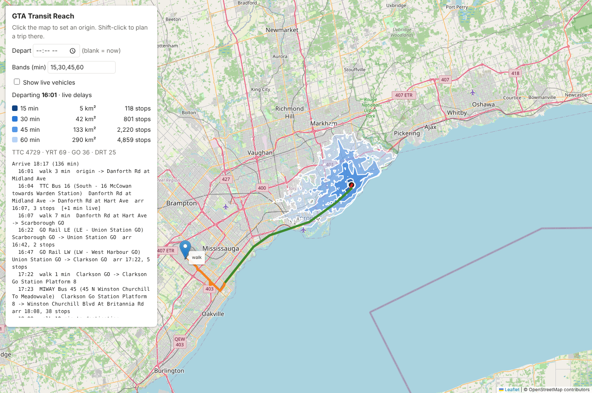

# TransitModeler: GTA Transit Network Model

**▶ Open the live map: [rahimb23.github.io/TransitModeler](https://rahimb23.github.io/TransitModeler/)**

A multi-agency GTFS + GTFS-Realtime model of transit across the Greater Toronto and Hamilton Area. It does:

- **Real-time schedules**: live delays and cancellations are applied to every trip that has a real-time feed.
- **Reachability (isochrones)**: how far you can get from a point in N minutes using transit and walking.
- **Journey planning**: earliest arrival between any two points, including transfers between agencies.
- **Departure boards and a live vehicle map.**
- **A web app** where you click anywhere to see live reachability (shift-click to plan a trip).





## Agencies

| Key | Agency | Static GTFS | Real-time |
|---|---|---|---|
| `ttc` | TTC | Toronto Open Data | BusTime vehicle positions (see note) |
| `go` | GO Transit | Metrolinx | TripUpdates if `GO_API_KEY` is set |
| `miway` | MiWay | miapp.ca | TripUpdates |
| `brampton` | Brampton Transit | Mobility Database mirror | none public |
| `yrt` | York Region Transit | yrt.ca | TripUpdates |
| `drt` | Durham Region Transit | maps.durham.ca | TripUpdates |
| `hsr` | Hamilton Street Railway | opendata.hamilton.ca | TripUpdates |
| `oakville` | Oakville Transit | Mobility Database mirror | none public |
| `burlington` | Burlington Transit | Mobility Database mirror | TripUpdates |

**TTC note:** TTC's BusTime GTFS-RT uses trip and stop IDs that don't match the published static GTFS. Route IDs do match. The model therefore matches each live vehicle to the scheduled trip on the same route that passes a stop within 200 m, heading the same direction, with the closest scheduled time. The difference between that time and now is the delay, and it is held for the rest of the trip. About 85–90% of vehicles get matched. When two buses on the same route are bunched, the matching can swap them.

**GO real-time:** register for a free key with Metrolinx Open Data, then `export GO_API_KEY=...`.

## Website (GitHub Pages)

**https://rahimb23.github.io/TransitModeler/**

Routing runs entirely in your browser, using the same Connection Scan Algorithm as the Python model:

- **Reach:** click anywhere (or search a stop) to see 15/30/45/60-minute reach.
- **Trip:** pick an origin and a destination.
- **Share:** links keep their state in the URL.
- **Transit lines:** an overlay you can toggle by mode: Subway, LRT, Streetcar, GO Train and Bus routes. It uses each agency's official route colours from `shapes.txt`. Hover a line to see its name.

Two GitHub Actions keep the site up to date:

- **`pages.yml`** runs daily and on every push to `main`. It downloads all the agencies' GTFS and exports the next 3 days of schedules as hourly binary chunks (about 1 MB each). It then deploys the site from `web/` to Pages.
- **`live.yml`** runs about every 10 minutes. It fetches the GTFS-Realtime feeds and works out each trip's current delay and cancellations, plus vehicle positions. It force-pushes the result as `live.json` to the `live` branch. The agencies' feeds don't allow browser requests (no CORS headers), so the site reads `live.json` from raw.githubusercontent.com instead.

### One-time setup

1. **Settings → Pages → Build and deployment → Source: GitHub Actions.**
2. *(Optional)* Add your Metrolinx key as the repository secret `GO_API_KEY` to get live GO delays.

GitHub may run scheduled workflows late, and the raw file is cached for about 5 minutes. In practice, live data on the site is usually 5–20 minutes old.

TTC's BusTime server doesn't accept connections from GitHub's runners, so on the website TTC runs on its schedule. The other real-time agencies are live. TTC live data still works when you run the Python model or `serve` from your own machine. Running `live.yml` on a self-hosted runner would also bring TTC to the site. GitHub also pauses scheduled workflows after 60 days without repository activity; re-enable them from the Actions tab.

To preview locally:

```bash
python -m gta_transit export-web --out _site --live-url live/live.json
```

```bash
python -m gta_transit export-live --out _site/live/live.json
```

```bash
cp web/* _site/
```

```bash
python -m http.server -d _site 8000
```

## Setup

```bash
pip install -r requirements.txt
```

```bash
python -m gta_transit update
```

`update` downloads about 90 MB of GTFS and preprocesses it into `data/cache`. Run it every few weeks, or whenever service changes.

## Usage

```bash
python -m gta_transit info
```

```bash
python -m gta_transit isochrone "Union Station GO" --bands 15,30,45,60 --out out/iso.html --geojson out/iso.geojson
```

```bash
python -m gta_transit isochrone 43.7735,-79.2578 --date 2026-11-24 --at 08:00 --no-realtime
```

```bash
python -m gta_transit route "Finch Station" "43.5933,-79.6423" --map out/trip.html
```

```bash
python -m gta_transit departures "Kipling Station"
```

```bash
python -m gta_transit vehicles --out out/vehicles.html
```

```bash
python -m gta_transit serve --port 8000
```

- Places can be given as `lat,lon` or as part of a stop name.
- `--feeds ttc,go` limits the network to those agencies.
- Real-time is on by default when the departure time is within 3 hours of now.
- `serve` refreshes the real-time data every 60 seconds.

### Python API

```python
import datetime as dt
from gta_transit.network import Network
from gta_transit.realtime import refresh
from gta_transit.isochrone import isochrones
from gta_transit.router import plan

net = Network(dt.date.today())
refresh(net)                                        # apply live delays
iso = isochrones(net, 43.6453, -79.3806, net.secs_of(dt.datetime.now()), (15, 30, 60))
res, stop, arrival, egress = plan(net, 43.78, -79.41, 43.59, -79.64, 8 * 3600)
print(res.describe_journey(stop, egress))
```

## How it works

1. **`static.py`** parses each agency's zip into parquet tables:
   - stops, routes, trips and stop_times, with times as integer seconds;
   - non-timepoint stops get times interpolated within the trip;
   - `frequencies.txt` trips are expanded;
   - the calendar is resolved into (service_id, date) pairs.
2. **`network.py`** builds one service day across all agencies:
   - Previous-day trips that run past midnight are included, shifted by −24 h.
   - Each pair of consecutive stops on a trip becomes a *connection*. The connection array is sorted by departure time, about 1.8M connections on a weekday.
   - Walking transfers link every pair of stops within 400 m (via a KD-tree), at 1.3 m/s with a 1.3× detour factor. That is about 270k links.
3. **`realtime.py`** handles GTFS-RT TripUpdates:
   - Delays are propagated downstream, following the GTFS-RT spec.
   - Times are kept monotonic along each trip, and cancelled trips are removed.
   - The connection array is then re-sorted.
4. **`router.py`** runs the Connection Scan Algorithm, compiled with numba. One-to-all earliest arrival takes about 2–5 ms for a 1-hour budget.
   - It includes a 60 s minimum transfer, footpath relaxation and journey reconstruction.
5. **`isochrone.py`** builds the reachability polygons. Each reached stop gets a walking circle sized by the time left (capped at 1 km), and the circles are merged with shapely for each time band.

## Limitations

- Walking is straight-line × 1.3, not a street network. Rivers, ravines and highways can make the real walk longer, especially at the edge of an isochrone.
- Footpaths are a single hop of up to 400 m. Transfer chains that need several footpaths are not modelled.
- Fares, and GO's fare integration, are ignored. The router optimises arrival time only.
- Brampton, Oakville and Burlington static feeds come from the Mobility Database mirror, because the agencies' own URLs have moved. Brampton and Oakville have no public real-time feed.
- When a trip's real-time update starts partway along, the stops before it are given the same delay. Those stops have usually already been served.

Data: City of Toronto Open Data Licence, Open Government Licence – Ontario (Metrolinx), and each municipality's open data terms. Attribution is required.
